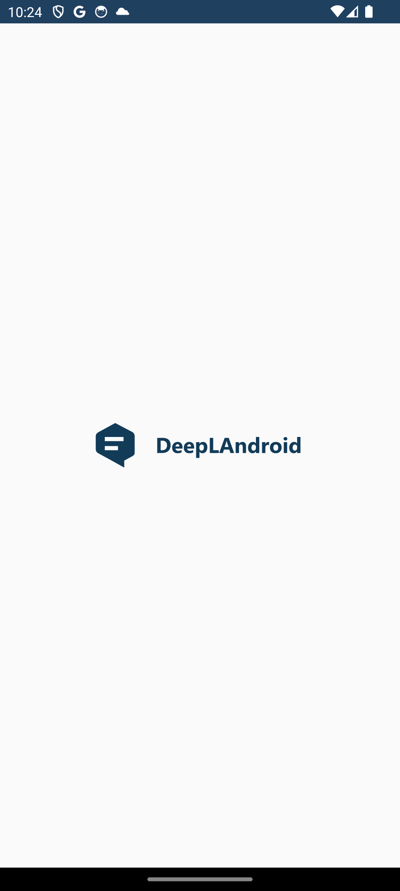
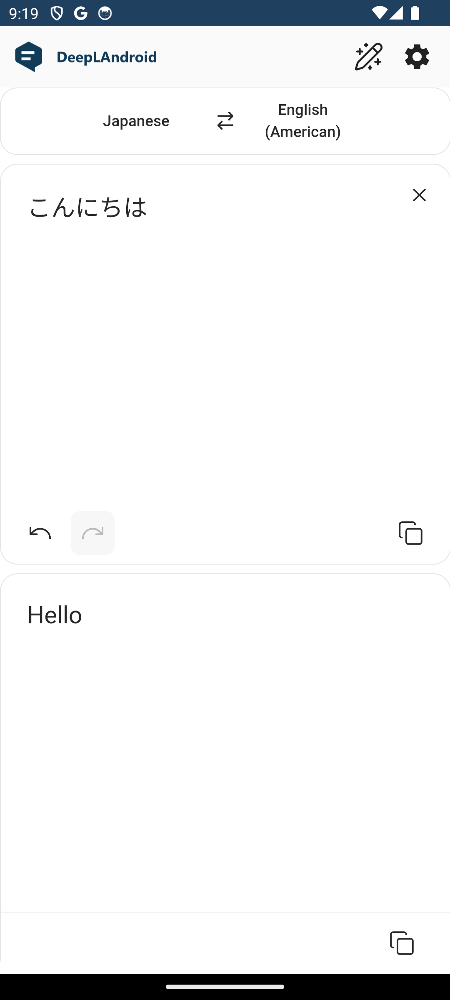
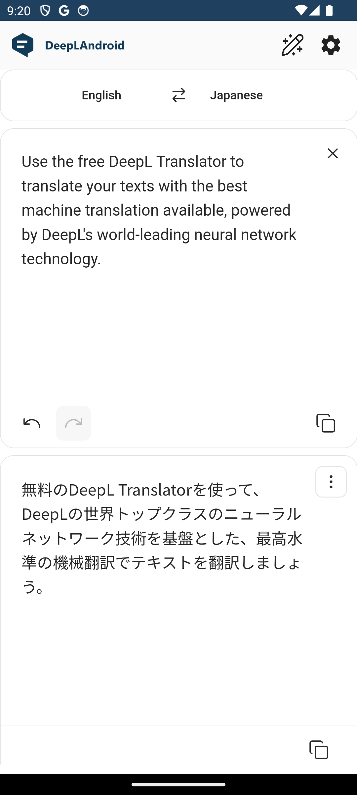
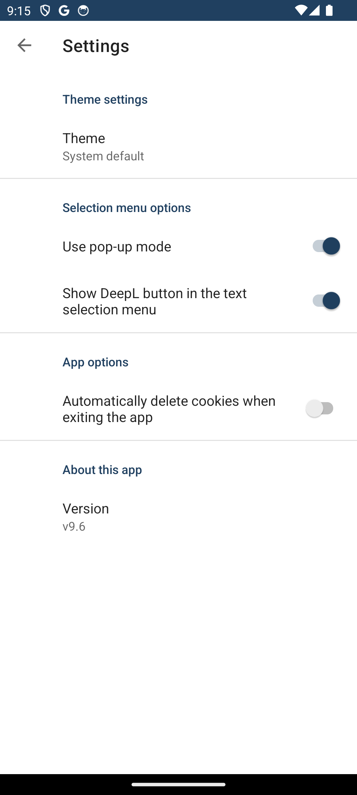

#### [EN](https://github.com/sakusaku3939/DeepLAndroid#readme) | [JA](README_JA.md) | [RU](README_RU.md) | [DE](README_DE.md) | [FR](README_FR.md) | [IT](README_IT.md) | [TR](README_TR.md) | [ZH](README_ZH.md) | [CS](README_CS.md)
# DeepLAndroid
    

Toto je neoficiální Android aplikace pro DeepL překlady.  
Využívá technologii WebView, komponentu grafického uživatelského rozhraní systému Android, aby vypadala jako nativní aplikace.  
JavaScript se používá ke skrytí všech prvků kromě těch nejnutnějších  

<table>
  <tr>
    <td width="25%"></td>
    <td width="25%"></td>
    <td width="25%"></td>
    <td width="25%"></td>
  </tr>
</table>

## Funkce
- Zobrazení pouze obrazovky překladu pomocí WebView.
- Přepínání do tmavého režimu.
- Spuštění DeepL z akce výběru v plovoucím textu.
- Dlouhý stisk ikony aplikace umožňuje otevřít obrazovku s nastavením.

## Poznámky
Tento projekt byl přeložen pomocí DeepL. Pokud se v něm vyskytnou nějaké chyby v překladu, neváhejte poslat pull request!

## Licence
[MIT](https://github.com/sakusaku3939/DeepLAndroid/blob/master/LICENSE)
